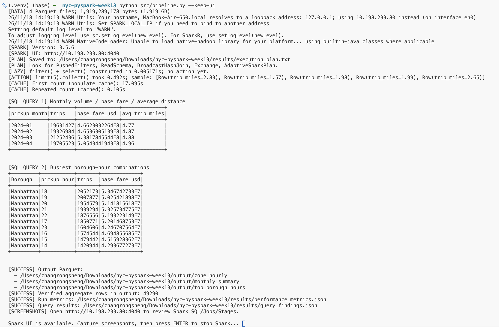
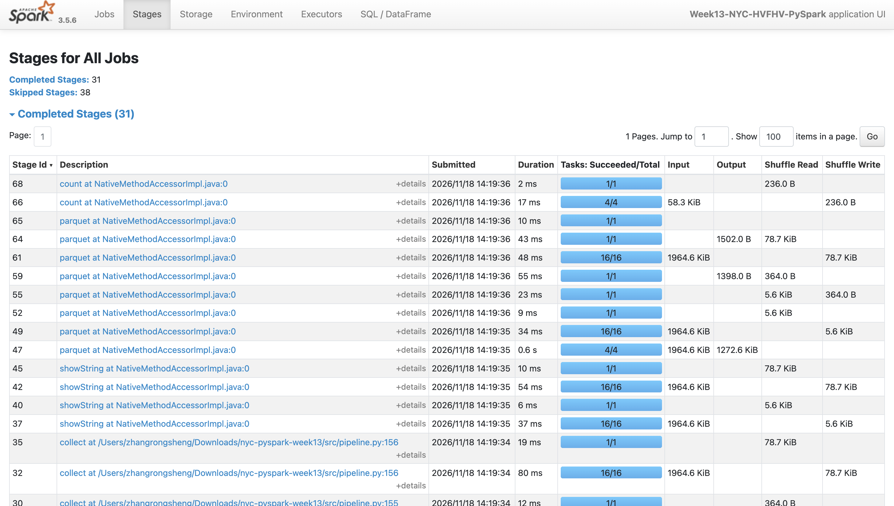

# NYC HVFHV Trip Analytics with PySpark

**Duke University | Week 13 Mini Assignment: PySpark Data Processing**  
**Technology:** PySpark 3.5.6, Spark SQL, Parquet, Python 3.11, Java 17  
**Dataset:** NYC Taxi & Limousine Commission (TLC) High Volume For-Hire Vehicle (HVFHV) trips, January–April 2024  
**Execution environment:** Local Apache Spark on macOS (`local[4]`)  
**Last successful full-data run:** November 18, 2026

## 1. Project overview

This project implements a reproducible PySpark pipeline for processing large-scale New York City rideshare trip data. The pipeline reads four monthly Parquet datasets, filters invalid records, engineers temporal features, joins trip records with taxi-zone metadata, computes grouped aggregations, runs two Spark SQL queries, and writes analytical outputs back to Parquet.

The assignment focuses on **distributed data processing, lazy evaluation, Spark query optimization, execution-plan inspection, and performance analysis**. The full run completed successfully using **1,919,289,178 bytes (1.919 decimal GB)** of raw trip Parquet data, satisfying the **1 GB+** input requirement.

### Dataset and sources

| Source | Coverage / purpose | Format |
|---|---|---|
| NYC TLC HVFHV Trip Records | January–April 2024; pickup time, zone ID, trip miles, fare, tip, provider | Four Parquet files |
| NYC Taxi Zone Lookup | Maps `PULocationID` to `Borough` and `Zone` | CSV |

- [Official TLC trip record data](https://www.nyc.gov/site/tlc/about/tlc-trip-record-data.page)
- [HVFHV trip record data dictionary](https://www.nyc.gov/assets/tlc/downloads/pdf/data_dictionary_trip_records_hvfhs.pdf)
- [Taxi zone lookup CSV](https://d37ci6vzurychx.cloudfront.net/misc/taxi_zone_lookup.csv)
- Trip file pattern: `https://d37ci6vzurychx.cloudfront.net/trip-data/fhvhv_tripdata_2024-MM.parquet` (months `01` through `04`)

**Scope of the results:** The analysis uses *cleaned and filtered records*, not all raw TLC trips. Rows are retained only if pickup time falls within January–April 2024, distance is greater than 0 and at most 50 miles, base fare is positive, and pickup zone/provider identifiers are present. The fare metric is `base_passenger_fare`, **not** the total amount paid by passengers or drivers' earnings.

## 2. Repository structure

```text
nyc-pyspark-week13/
├── README.md
├── requirements.txt
├── .gitignore
├── scripts/
│   └── download_data.py
├── src/
│   └── pipeline.py
├── data/
│   └── raw/                    # downloaded datasets; excluded from Git
├── output/                     # generated Parquet; excluded from Git
│   ├── zone_hourly/
│   ├── monthly_summary/
│   └── top_borough_hours/
├── results/
│   ├── execution_plan.txt
│   ├── performance_metrics.json
│   └── query_findings.json
└── screenshots/
    ├── 01-execution-plan.png
    ├── 02-query-details.png
    ├── 03-successful-run.png
    ├── 04-jobs-stages.png
    └── 05-cache-times.png
```

Large inputs and generated Parquet output are intentionally excluded from Git. Both are reproducible from the included downloader and pipeline scripts.

## 3. Installation and reproduction

### Prerequisites

- macOS or another environment capable of running local Spark
- Python 3.11
- Java 17
- Sufficient local storage and memory to process the 1.919 GB compressed input

Install and activate the environment from the repository root:

```bash
# macOS with Homebrew
brew install python@3.11 openjdk@17
export JAVA_HOME=/opt/homebrew/opt/openjdk@17/libexec/openjdk.jdk/Contents/Home

python3.11 -m venv .venv
source .venv/bin/activate
python -m pip install -r requirements.txt

java -version
python -c "import pyspark; print(pyspark.__version__)"
```

Download and run the **full** dataset:

```bash
python scripts/download_data.py
python src/pipeline.py --keep-ui
```

The downloader checks the downloaded file sizes. The pipeline independently checks that the combined raw trip Parquet files contain at least **1,000,000,000 bytes**, unless the development-only `--allow-small-input` flag is set.

If Python encounters `SSL: CERTIFICATE_VERIFY_FAILED` when downloading the files, the following certificate-bundle configuration resolved that issue in the tested environment:

```bash
python -m pip install --upgrade certifi
export SSL_CERT_FILE="$(python -c 'import certifi; print(certifi.where())')"
python scripts/download_data.py
```

For a smaller **development-only** test (not sufficient for the assignment's 1 GB requirement):

```bash
python scripts/download_data.py --months 1
python src/pipeline.py --months 1 --allow-small-input
```

## 4. Data processing pipeline

The main implementation is in [`src/pipeline.py`](src/pipeline.py).

| Stage | Spark technique | Implementation |
|---|---|---|
| Input loading | `spark.read.parquet` | Reads four HVFHV monthly files |
| Column pruning | `select` | Projects six trip columns before the join |
| Early filtering | Multiple `filter` operations | Restricts pickup dates, distance, fare, and non-null IDs |
| Feature engineering | `withColumn` | Derives `pickup_month`, `pickup_hour`, `fare_usd`, `tip_usd` |
| Lookup enrichment | `join` + `broadcast` | Adds borough and zone from a small dimension table |
| Distributed aggregation | `groupBy` + `count` / `sum` | Groups by month, hour, borough, zone, and provider |
| SQL analysis | `spark.sql` | Two business-oriented analytical queries |
| Output | `write.parquet`, `partitionBy`, `coalesce` | Writes three result tables and verifies the main output |

### Spark SQL queries

**Query 1 — Monthly demand, base fare, and average trip distance**

```sql
SELECT pickup_month,
       SUM(trip_count) AS trips,
       ROUND(SUM(total_base_fare), 2) AS base_fare_usd,
       ROUND(SUM(total_miles) / SUM(trip_count), 2) AS avg_trip_miles
FROM zone_hourly
GROUP BY pickup_month
ORDER BY pickup_month;
```

**Query 2 — Top 10 busiest borough-hour combinations**

```sql
SELECT Borough, pickup_hour,
       SUM(trip_count) AS trips,
       ROUND(SUM(total_base_fare), 2) AS base_fare_usd
FROM zone_hourly
GROUP BY Borough, pickup_hour
ORDER BY trips DESC
LIMIT 10;
```

The SQL queries operate on the `zone_hourly` temporary view created from the cached aggregate, rather than rescanning all raw input records for each query.

## 5. Performance analysis

The measurements below come from the successful **November 18, 2026** full-data run on **PySpark 3.5.6**. They represent one local execution, not an average over repeated independent benchmark runs.

| Measurement | Observed result |
|---|---:|
| Raw Parquet input | **1,919,289,178 bytes (1.919 GB)** |
| Input Parquet files | **4** |
| Aggregated output rows | **49,290** |
| Lazy DataFrame construction | **0.005171 s** |
| `limit(5).collect()` action | **0.492 s** |
| First aggregate `count()` and cache population | **17.095 s** |
| Repeated cached aggregate `count()` | **0.105 s** |
| Monthly SQL `collect()` | **0.221 s** |
| Peak-hour SQL `collect()` | **0.160 s** |
| Main aggregate Parquet write | **0.750 s** |
| Read-back output verification | **0.097 s** |
| Verified written rows | **49,290** |

**Query optimization and filter placement.** The pipeline selects only six source fields before any expensive join or aggregation and places six data-quality/date filtering conditions early in the transformation chain. Spark's Catalyst optimizer can combine compatible filters and perform column pruning during Parquet reads. The script enables Parquet predicate pushdown (`spark.sql.parquet.filterPushdown=true`), explicitly requests a broadcast join for the small taxi-zone lookup, and enables adaptive query execution. The saved [`results/execution_plan.txt`](results/execution_plan.txt) contains both extended and formatted plans, allowing `PushedFilters`, `ReadSchema`, `BroadcastHashJoin`, and `AdaptiveSparkPlan` to be checked against the actual plan. Not every filter is necessarily pushed into the Parquet reader; the physical plan, rather than the code alone, determines which predicates were pushed down.

**Bottlenecks and data movement.** The main expensive operation is the initial computation of the grouped aggregation over four months of data; it includes filtering, enrichment, and grouping by month, hour, borough, zone, and provider. Grouping is a wide transformation that may require a hash-partition exchange (shuffle) to combine records with the same key. The first aggregation `count()` plus cache population required **17.095 seconds**, making it much more expensive than the downstream actions on the smaller aggregate. The Spark UI showed **31 completed stages** and measurable shuffle reads/writes. The pipeline reduces data movement by pruning/filtering before the join, broadcasting the zone dimension, using 16 configured shuffle partitions, and coalescing the **already aggregated** result to four partitions before the month-partitioned Parquet write. The measured main write took **0.750 seconds**, and re-reading the output verified all **49,290** aggregate rows.

**Lazy evaluation, caching, and repeated queries.** Creating `filter()` and `select()` transformations took **0.005171 seconds** without executing a data-processing job. Calling `limit(5).collect()` then triggered an action and took **0.492 seconds**, demonstrating the distinction between lazy transformations and eager actions. The first count, which computed the aggregate and filled its cache, took **17.095 seconds**; repeating the count using cached results took **0.105 seconds**. This corresponds to an illustrative **162.8× time ratio**, but it is **not** a controlled speedup measurement because the first timing also includes upstream processing and cache population. Reusing the cached aggregated view enabled the two subsequent SQL `collect()` actions to complete in **0.221** and **0.160 seconds**, respectively.

### Execution-plan and Spark UI evidence

The source of truth for the explain plan is [`results/execution_plan.txt`](results/execution_plan.txt), generated by `zone_hourly.explain(mode='extended')` and `zone_hourly.explain(mode='formatted')`. The Spark UI can be inspected during `--keep-ui` execution at the URL printed in the terminal (port **4040** for the recorded run). It is a live local address and will not remain publicly accessible after the application exits.

The following images document the actual run. The first displays the beginning of the *extended logical plan*; the second is the *SQL/DataFrame overview*, not the expanded details page for an individual query. For full rubric coverage, also capture the **Physical Plan** portion of `execution_plan.txt` and an **individual SQL query's details/DAG page** in Spark UI before submitting.

| Screenshot | What it shows |
|---|---|
| [Execution plan](screenshots/01-execution-plan.png) | Extended explain output in VS Code (logical-plan section visible) |
| [SQL/DataFrame overview](screenshots/02-query-details.png) | 13 completed SQL/DataFrame executions |
| [Successful pipeline](screenshots/03-successful-run.png) | Two SQL result tables, three Parquet destinations, output validation |
| [Spark stages](screenshots/04-jobs-stages.png) | 31 completed stages, task counts, shuffle metrics |
| [Lazy evaluation and caching](screenshots/05-cache-times.png) | Lazy vs. action timing and initial/repeated cached count |





## 6. Key data findings

Results below are calculated from the *filtered* HVFHV trips included in the pipeline.

### Monthly trip statistics

| Month (2024) | Filtered trips | Base passenger fares (USD) | Average trip distance (miles) |
|---|---:|---:|---:|
| January | 19,631,427 | $466,230,322.64 | 4.77 |
| February | 19,326,984 | $465,363,051.39 | 4.87 |
| March | **21,252,436** | **$538,178,455.44** | 4.88 |
| April | 19,705,523 | $505,434,419.43 | 4.96 |
| **Total** | **79,916,370** | **$1,975,206,248.90** | — |

- **March had the highest filtered trip volume**, with 21.25 million trips, approximately **10.0%** more than February.
- The **average trip distance** increased from **4.77 miles in January** to **4.96 miles in April**. These are averages over the filtered trip records and should not be interpreted as a causal trend.
- All ten of the busiest *borough-hour combinations* in the returned top-10 query were in **Manhattan**. The highest was **Manhattan at 18:00–18:59**, with **2,052,173 trips** and **$53,467,427.33** in base passenger fares across the four-month analysis window.

Results are also saved in [`results/query_findings.json`](results/query_findings.json) for reproducibility.

## 7. Output and validation

The pipeline writes three result datasets:

| Output | Content |
|---|---|
| `output/zone_hourly/` | Main aggregate, partitioned by `pickup_month` |
| `output/monthly_summary/` | Output of SQL Query 1 |
| `output/top_borough_hours/` | Output of SQL Query 2 |

The main output is read back from disk using Spark and counted. **49,290 rows written = 49,290 rows read back**, so the write/read verification passed. The Parquet outputs are excluded from version control because they can be reproduced by running the pipeline.

For machine-readable evidence, see [`results/performance_metrics.json`](results/performance_metrics.json), [`results/query_findings.json`](results/query_findings.json), and [`results/execution_plan.txt`](results/execution_plan.txt).

## 8. Assignment requirement mapping

| Requirement | Evidence in this repository |
|---|---|
| 1 GB+ data loading | Four official TLC Parquet files; byte count validated at runtime |
| Two or more filters | Pickup datetime, trip distance, positive base fare, non-null keys |
| Join or complex aggregation | Broadcast zone lookup join **and** multi-key `groupBy` |
| `withColumn` | Month, hour, fares, tips |
| Two SQL queries | Monthly statistics and borough/hour ranking |
| Optimization | Early projection/filtering, broadcast hint, AQE, shuffled aggregation, controlled output partitioning |
| Output writing | Three Parquet tables; month partitioning; successful read-back verification |
| `.explain()` and Spark UI | Saved extended/formatted plans; screenshots and stage metrics |
| Performance analysis | Three paragraphs of measured analysis (Section 5) |
| Actions vs. transformations | Lazy construction vs. `collect()` timing; repeated cached count |
| Optional MLlib | Not implemented; optional and worth **0 points** in the provided rubric |

---

**Reproducibility note:** Performance depends on machine resources, input data, Spark configuration, and cache state. The values above describe the successful local run on November 18, 2026. Raw data and generated output are not committed to Git; the included scripts reproduce them.
# ids706-pyspark-week13
